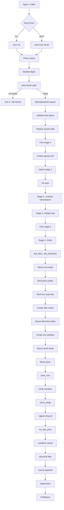

<p align="center">
  
</p>

<h1 align="center">Carapace</h1>

<p align="center">
  <strong>Run code written by AI agents. Keep your machine.</strong><br>
  A local execution sandbox for untrusted code. One binary. No daemon. No Docker. No root.
</p>

<p align="center">
  <a href="https://github.com/vanshcodeworks/Carapace/actions/workflows/ci.yml"></a>
  
  
  
  <a href="https://github.com/vanshcodeworks/Carapace/blob/main/docs/agent/CLAIMS.md"></a>
</p>

---

## What is Carapace

Carapace is a local sandbox for untrusted code. It is built for code that an AI agent writes and wants to run.

You give it a program and a policy. It runs the program in a locked-down box. It returns the output, the exit code, and the reason the program stopped. Your files, your network, and your processes stay outside the box.

It is one binary. It starts in milliseconds. It does not need a daemon, Docker, or root.

## Why it exists

AI agents are good at writing code. They are not always good at knowing what is safe to run.

A normal agent needs a shell to test its work. A shell on your laptop can read your keys, change your files, and open a network connection. Carapace gives the agent a smaller door:

- run this program
- with these limits
- with this policy
- and return the result

That is the whole product.

---

## Feature Status

| Feature | Status | Notes |
|---------|--------|-------|
| `cara run` | ✅ Implemented | One-shot sandbox with limits and JSON report |
| `cara session` | ✅ Implemented | Persistent `/work` across execs, fresh sandbox each exec |
| `cara mcp` | ✅ Implemented | MCP server with 8 tools for agent clients |
| `cara doctor` | ✅ Implemented | Measures host capabilities, fails closed when not ready |
| `cara policy` | ✅ Implemented | Strict TOML, `check` and `explain` |
| Tier 1 native | ✅ Supported | Namespaces, cgroups v2, Landlock, seccomp, capability drop |
| Tier 2 Wasm | 🧪 Library backend | Parity tests pass, `cpu_time`, `peak_memory_bytes`, `kill()` via shared Engine |
| Tier 3 microVM | 🚧 Implemented | libkrun boot path, payload-as-init, virtiofs `/work`, fails closed without KVM |

---

## Product Demonstration

### One-shot execution

```sh
cara run -- /bin/sh -c 'echo hello from the sandbox'
cara run --json -- /usr/bin/python3 -c 'print(6 * 7)'
```

### Persistent session

```sh
id=$(cara session start --policy dev.toml)
cara session exec "$id" -- /bin/sh -c 'echo data > /work/input.txt'
cara session exec "$id" -- /bin/sh -c 'cat /work/input.txt'
cara session close "$id"
```

The file survives. The process does not. Each `session exec` gets a new PID namespace and a new root filesystem.

### Agent connection (MCP)

```json
{
  "mcpServers": {
    "carapace": {
      "command": "/home/YOU/.local/bin/cara-mcp",
      "args": []
    }
  }
}
```

The agent gets these tools: `run_code`, `explain_result`, `session_create`, `session_exec`, `session_upload`, `session_download`, `session_list`, `session_close`.

---

## Security Architecture



### Trust Boundary

```
┌─────────────────────────────────────────────────────────────────┐
│                        HOST MACHINE                             │
│  ┌─────────────────────────────────────────────────────────┐   │
│  │                    CARAPACE SUPERVISOR                    │   │
│  │  • Policy validation (fail closed)                        │   │
│  │  • Doctor capability checks                               │   │
│  │  • cgroup v2 leaf creation                                │   │
│  │  • Stage-1 fork and attach                                │   │
│  └──────────────────────┬────────────────────────────────────┘   │
│                         │                                        │
│         ┌───────────────┴───────────────┐                       │
│         ▼                               ▼                       │
│  ┌─────────────────┐           ┌─────────────────┐             │
│  │   STAGE-1       │           │   STAGE-2       │             │
│  │  (no namespaces)│           │  (PID ns init)  │             │
│  │  • parked       │           │  • namespaces   │             │
│  │  • cgroup leaf  │           │  • pivot_root   │             │
│  └────────┬────────┘           │  • Landlock     │             │
│           │                    │  • seccomp      │             │
│           │                    │  • caps dropped │             │
│           │                    │  • execve       │             │
│           └────────┬───────────┘────────┬────────┘             │
│                    │                    │                      │
│                    ▼                    ▼                      │
│         ┌─────────────────────────────────────────┐           │
│         │           SANDBOX PAYLOAD               │           │
│         │  • Fresh PID / mount / net / IPC / UTS  │           │
│         │  • Read-only /usr                       │           │
│         │  • No /home, /root, /sys                │           │
│         │  • /work tmpfs (size capped)            │           │
│         │  • CPU, memory, PIDs, disk, output caps │           │
│         │  • seccomp allowlist (~140 syscalls)    │           │
│         └─────────────────────────────────────────┘           │
└─────────────────────────────────────────────────────────────────┘
```
 
---
 
## Tier 3 microVM (libkrun)
 
Carapace Tier 3 uses **libkrun** to boot a disposable Linux kernel under KVM. The payload runs as init (pid 1) in its own kernel - the host kernel is never shared.
 
| Property | Value |
|----------|-------|
| VMM | libkrun (Firecracker second) |
| Kernel | Bundled minimal kernel (init-blob) |
| Memory | 64 MiB - 16 GiB (policy mapped, floors/ceilings applied) |
| vCPUs | 1 - 64 (ceil(cpu_percent / 100)) |
| Rootfs | Read-only skeleton via virtiofs |
| Writable | `/work` via virtiofs (size-capped) |
| Network | None (by design) |
| Console | Captured to temp file (byte-capped) |
 
**Status:** Implemented via libkrun with init-blob. Fails closed without `/dev/kvm` or if init-blob unavailable. Not yet exposed via CLI (backend only).
 
**Run a microVM (backend only):**
```rust
use carapace_vm::{VmBackend, VmPlan};
let backend = VmBackend::new();
let plan = VmPlan::from_limits(&limits).unwrap();
// backend.spawn(&spec) // blocks until VM exits
```
 
---
 
## Attack Containment

Every row is a test in the escape suite (crate `carapace-escape-tests`). The payload runs through the real sandbox and the suite asserts the documented result. The table is generated from the test catalog, so it cannot drift from what is actually tested.

### Process Exhaustion

| Test | Attack | Result |
|------|--------|--------|
| `fork_bomb` | Fork bomb | Capped by pids.max and killed at the timeout; peak process count stays near the cap and no stragglers survive on the host |

### Resource Exhaustion

| Test | Attack | Result |
|------|--------|--------|
| `memory_hog` | Memory hog | OOM-killed at the memory limit (KillReason::MemoryLimit) with peak memory near the cap; the host is unaffected |
| `cpu_spin` | CPU spin | Killed at the wall timeout with cpu_time close to the cpu.max quota (100 percent of one core) |
| `disk_filler` | Disk filler | Writes fail with ENOSPC (8 MiB root tmpfs) or the RLIMIT_FSIZE / scratch-size cap; the host filesystem is untouched |
| `output_flood` | Output flood | Killed with KillReason::OutputOverflow at the output cap; captured output stays capped |

### Filesystem Isolation

| Test | Attack | Result |
|------|--------|--------|
| `read_etc_passwd` | Read /etc/passwd | Succeeds but shows the sandbox's own passwd (carapace-sandbox-marker), never host users |
| `read_shadow` | Read /etc/shadow | The file does not exist inside the sandbox; cat fails |
| `read_home` | Read /home and /root | Neither exists inside the sandbox (No such file or directory) |
| `write_outside` | Write outside the sandbox | Both writes denied: /usr is read-only (EROFS), /etc is denied by Landlock; no host file appears |
| `write_then_exec` | Write then execute | The file is created but Landlock denies execve on writable locations: the written program never runs (Permission denied, rc=126) |
| `symlink_escape` | Symlink escape | The link resolves to the sandbox's own /etc/passwd within the Landlock scope; the host file is untouched |

### Namespace Isolation

| Test | Attack | Result |
|------|--------|--------|
| `proc_escape` | /proc inspection | /proc/1 is the sandbox's own shell and the pid space is fresh (max pid <= 10); host processes are invisible |

### Privilege Escalation

| Test | Attack | Result |
|------|--------|--------|
| `setuid_escalation` | setuid escalation | Every uid change fails with EPERM (no CAP_SETUID); setuid bits in the read-only /usr bind are inert: CapEff=0000000000000000 and NoNewPrivs=1 |

### System Call Restrictions

| Test | Attack | Result |
|------|--------|--------|
| `ptrace_attempt` | ptrace injection | Denied with EPERM: ptrace is not in the seccomp allowlist |
| `mount_attempt` | mount(2) attempt | Denied with EPERM: mount(2) is not in the seccomp allowlist |
| `unshare_attempt` | unshare(2) escape | Denied with EPERM: unshare(2) is not in the seccomp allowlist |

### Network Restrictions

| Test | Attack | Result |
|------|--------|--------|
| `socket_egress` | Network egress | Denied with EPERM on socket(2): no sockets exist (empty netns plus seccomp); the connection is never made |
| `abstract_unix_escape` | Abstract Unix socket | Denied with EPERM: socket(2) itself is denied, so the abstract namespace is unreachable |

### Kernel Interface Abuse

| Test | Attack | Result |
|------|--------|--------|
| `keyring_abuse` | Keyring abuse | Denied with EPERM: keyring syscalls are not in the seccomp allowlist |

### Information Leakage

| Test | Attack | Result |
|------|--------|--------|
| `fd_leak_scan` | FD leak scan | Exactly 0, 1, 2 plus the scanner's own transient directory fd; nothing else leaks in |
| `env_leak` | Environment leak | The child sees exactly the allowlisted variables the spec set; nothing is inherited from the host |

### Additional Red-Team Coverage

The red-team suite (`tests/redteam.rs`, 31 tests) covers chroot, mknod, sethostname, /proc/sys writes, cross-hierarchy rename, zombie hoards, dual-stream floods, slow-drip output, hostile argv, the new mount API, memfd, mmap exec, and more. All are denied or contained.

---

## Threat Model Boundaries

**Tier 1 does not promise:**
- Protection against a Linux kernel exploit. All namespaces share the host kernel. A payload that exploits the kernel from inside can escape. This is why Tiers 2 and 3 exist.
- Side channels (Spectre-class, Rowhammer).
- Hardware/DMA attacks.
- The host already being compromised by other means.
- Misconfiguration by the trusted user who writes the policy.

See [docs/threat-model.md](docs/threat-model.md) for the complete model.

---

## Installation

You need Linux x86_64. WSL2 works. You need Rust 1.85 or newer and git.

### With the installer (recommended)

```sh
git clone https://github.com/vanshcodeworks/Carapace.git
cd Carapace
bash scripts/install.sh
```

The installer builds `cara` and `cara-mcp`, installs them in `~/.local/bin`, and runs `cara doctor`. If doctor fails, Carapace will not run code. Fix the host first. The installer prints the exact remedy.

### Manual build

```sh
cargo build --release -p carapace-cli -p carapace-mcp
./target/release/cara doctor
./target/release/cara run -- /bin/sh -c 'echo hello from the sandbox'
```

---

## Quick Start

```sh
# 1. Check your host
cara doctor

# 2. Run a command
cara run -- /bin/sh -c 'echo hello from the sandbox'

# 3. Run with JSON output
cara run --json -- /usr/bin/python3 -c 'print(6 * 7)'

# 4. Use a session for persistent files
id=$(cara session start --policy dev.toml)
cara session exec "$id" -- /bin/sh -c 'echo data > /work/input.txt'
cara session exec "$id" -- /bin/sh -c 'cat /work/input.txt'
cara session close "$id"
```

---

## CLI Reference

### Run a command

```sh
cara run [OPTIONS] -- <PROGRAM> [ARGS...]

Options:
  --policy FILE    Policy file (TOML). Without one, the strict preset applies.
  --json           Machine-readable JSON report on stdout.
  --timeout DUR    Override the wall-clock timeout (e.g. "30s").
```

### Manage sessions

```sh
cara session start [--policy FILE] [--json]     # Create session, prints ID
cara session exec ID [--timeout DUR] [--json] -- <PROGRAM> [ARGS...]
cara session put ID <local> <remote>            # Upload file to session /work
cara session get ID <remote> <local>            # Download file from session /work
cara session ls ID [PATH] [--json]              # List directory in session
cara session list [--json]                      # List all sessions
cara session close ID                           # Close session, remove /work
cara session prune [--json]                     # Remove dead sessions
```

### Policy commands

```sh
cara policy check FILE [--json]    # Validate policy (exit 0 = valid, 3 = invalid)
cara policy explain FILE           # Print what the policy allows in plain English
```

### Doctor and MCP

```sh
cara doctor [--json]               # Check host capabilities
cara mcp                           # Run MCP server on stdio
```

---

## MCP Integration

Build once:

```sh
cargo build --release -p carapace-mcp
```

The server binary is `target/release/cara-mcp`, or `~/.local/bin/cara-mcp` after the installer.

### Claude Desktop

Settings → Developer → Edit Config:

```json
{
  "mcpServers": {
    "carapace": {
      "command": "/home/YOU/.local/bin/cara-mcp",
      "args": []
    }
  }
}
```

### Cursor

`~/.cursor/mcp.json` or project `.cursor/mcp.json`:

```json
{
  "mcpServers": {
    "carapace": {
      "command": "/home/YOU/.local/bin/cara-mcp",
      "args": []
    }
  }
}
```

The path must be absolute. The server runs on the same machine as the sandbox. There is no remote mode.

### Verify the connection

```sh
python3 scripts/mcp-smoke.py "$(command -v cara-mcp)"
```

This performs a real MCP handshake, lists all 8 tools, and runs one harmless shell command through the sandbox.

### Available tools

| Tool | Description |
|------|-------------|
| `run_code` | Execute a short shell or Python program in a one-shot sandbox |
| `explain_result` | Explain a sandbox report in plain English |
| `session_create` | Create a persistent session with size-capped `/work` |
| `session_exec` | Run code in a fresh sandbox using the session's `/work` |
| `session_upload` | Write base64 content to a file in the session work dir |
| `session_download` | Read a session file as base64 |
| `session_list` | List sessions created by this server with liveness |
| `session_close` | Stop a session and remove its work dir |

The server treats MCP input as hostile: size caps, field whitelists, absolute program paths, no shell interpolation. A request can narrow a policy but never widen it beyond local configuration.

---

## Policy Configuration

Policies are strict TOML. Unknown fields are rejected. Unknown units are rejected. A policy can never silently widen permissions (fail closed).

### Presets

```toml
# Strict: tight everything, no network (default)
preset = "strict"

# Dev: room to work, still no network, exec_on_write = true
preset = "dev"

# Network-light: dev limits with allowlist network (not implemented, fails closed)
preset = "network-light"
```

### Strict preset defaults

```toml
[limits]
timeout = "10s"
memory = "256MB"
max_processes = 32
disk = "64MB"
max_output = "1MB"

[filesystem]
read_only = []
read_write = []
exec_on_write = false

[network]
mode = "none"
```

### Custom policy example

```toml
preset = "strict"

[limits]
timeout = "30s"
memory = "512MB"
max_processes = 64
disk = "256MB"
max_output = "4MB"

[filesystem]
read_only = ["/opt/models", "/srv/datasets"]
read_write = ["/home/user/project"]
exec_on_write = false

[network]
mode = "none"
```

### Network modes

| Mode | Behavior |
|------|----------|
| `none` | Empty network namespace, seccomp denies socket(2) |
| `full` | Share host network namespace (loud opt-in) |
| `allowlist` | Not implemented, fails closed at run time |

---

## Supported Runtimes

The sandbox bind-mounts the host `/usr` read-only, so every interpreter your distro ships works without per-language setup. The P2 runtime matrix exercises these end-to-end (17 passed, 0 failed, 0 skipped on the reference WSL environment):

| Runtime | Exercised |
|---------|-----------|
| bash + coreutils | pipelines, sort/head, sed/awk, find/grep, date/expr |
| Python 3 | stdlib JSON/re/hashlib, subprocess, sqlite3, ssl (no network), threads, concurrent.futures, multiprocessing.Pool |
| Node.js | inline JSON, worker_threads from read-write bind |
| gcc | compile C program into read-write bind, exec result in sandbox |
| Rust | run host-built binary, exec from read-write bind |
| Go | build and run, including goroutines |
| OpenJDK | javac compile and run threaded Java |

The matrix skips optional runtimes (Node, gcc, rustc, Go, JVM) that are not installed. Other distro, kernel, and JDK layouts remain unverified.

---

## Workspace Structure

```
crates/
  cara-core          types: SandboxSpec, Policy (TOML), ExitReport, DoctorReport
  cara-sys           raw syscalls - ALL unsafe code confined here
  cara-native        Tier 1 backend: doctor, supervisor, child, rootfs, cgroups, seccomp
  cara-cli           the `cara` binary (doctor / run / policy / session / mcp)
  cara-mcp           MCP server with 8 tools
  cara-wasm          Tier 2 library backend
  cara-vm            Tier 3 design and fail-closed plan
  cara-escape-tests  hostile payload catalog + generated README table
docs/
  threat-model.md    what is defended, what is not - read this first
  policy.md          policy file reference
  architecture.md    how a run works
  runtime-guide.md   running languages
  troubleshooting.md doctor remedies
  mcp.md             MCP contract
  agents.md          agent workflows
  decisions/         ADRs
  agent/             working state: STATE, LOG, CLAIMS, UNVERIFIED
scripts/
  check.sh           full verification loop
  install.sh         build and install cara + cara-mcp
  mcp-smoke.py       real MCP handshake + run_code smoke test
  runtime-matrix.py  P2 runtime matrix
demo/                product demo (escape suite via CLI)
```

---

## Host Requirements

- Linux kernel ≥ 5.10 (developed on 6.18)
- cgroup v2 unified hierarchy with cpu, memory, pids delegation
- Unprivileged user namespaces (CLONE_NEWUSER)
- Landlock LSM (kernel ≥ 5.13, ABI probed at runtime)
- seccomp-bpf
- pidfd (kernel ≥ 5.3) and close_range (kernel ≥ 5.9) - optional but recommended
- Merged-usr layout (`/bin` → `/usr/bin`, `/lib` → `/usr/lib`)
- systemd for cgroup delegation (WSL2 needs `systemd-run --user --scope`)

Run `cara doctor` to measure your exact environment. It prints exact remedies for every missing capability.

---

## Limitations and Non-Goals

- **Network allowlist.** `network = "allowlist"` is partially implemented (seccomp user-notification for `connect(2)` works; full sandbox integration has issues - test skipped). Use `none` or `full` for production.
- **Windows and macOS native.** Linux only. WSL2 works. Windows `.exe` files not supported (see below).
- **aarch64.** The native tier is x86_64 only.
- **SDKs.** There is no Python or TypeScript SDK yet. Use MCP or the CLI.
- **Prebuilt binaries.** There is no release download yet. Build from source.
- **Kernel exploits.** Tier 1 shares the host kernel. A kernel exploit can escape. Tier 2 and Tier 3 exist to change that; Tier 2 not in CLI, Tier 3 implemented via libkrun (not in CLI).
- **Other distros.** The measured environment is WSL2 Ubuntu 24.04, kernel 6.18, x86_64. Other distros are not supported until they are measured. `cara doctor` is the gate.

---

## Documentation

- [Agent setup](AGENT_SETUP.md) - the file to hand to an agent
- [Agent guide](docs/agents.md) - MCP, sessions, policy recipes
- [Threat model](docs/threat-model.md) - what is defended and what is not
- [Policy reference](docs/policy.md) - every policy field
- [MCP guide](docs/mcp.md) - tools, caps, client config
- [Runtime guide](docs/runtime-guide.md) - Python, Node, Go, JVM, compilers
- [Troubleshooting](docs/troubleshooting.md) - doctor remedies
- [Architecture](docs/architecture.md) - how a run works
- [FAQ](docs/faq.md)
- [Claims ledger](docs/agent/CLAIMS.md) - every claim and its test
- [Unverified list](docs/agent/UNVERIFIED.md) - what is not proven yet

---

## Contributing

Read [CONTRIBUTING.md](CONTRIBUTING.md). The short rules:

- every security claim needs a named test
- hostile code runs only inside the sandbox
- new configuration fails closed
- docs must match measured behavior

---

## Security

Report vulnerabilities privately. See [SECURITY.md](SECURITY.md). Do not open a public issue for a security report.

---
 
## Running Windows `.exe` Files
 
Carapace is a **Linux sandbox** - it runs on Linux (or WSL2 on Windows) and executes **Linux ELF binaries**, not Windows `.exe` files.
 
### Option 1: Compile for Linux (Recommended)
```bash
# If you have source code, compile for Linux
rustc myprogram.rs -o myprogram        # Rust
gcc myprogram.c -o myprogram            # C
go build -o myprogram main.go           # Go
```
Then run in Carapace:
```bash
cara run -- ./myprogram
```
 
### Option 2: Run Windows `.exe` via Wine (if available)
If Wine is installed on the host at `/usr/bin/wine`:
```bash
cara run -- /usr/bin/wine myprogram.exe
```
**Requirements:**
- Wine must be installed on the host (`/usr/bin/wine`)
- The `.exe` must be accessible at the path you provide (or use `read_write` bind for the directory)
- 32-bit `.exe` files require 32-bit Wine libraries
 
### Option 3: Cross-compile from Windows
From Windows, cross-compile to Linux:
```bash
# Rust
rustc --target x86_64-unknown-linux-gnu myprogram.rs
 
# Go
GOOS=linux GOARCH=amd64 go build -o myprogram
 
# C/C++ with zig cc (cross-compiles easily)
zig cc -target x86_64-linux-gnu myprogram.c -o myprogram
```
 
### Why not `.exe` directly?
Carapace uses **Linux namespaces, cgroups, Landlock, seccomp** - all Linux kernel features. It cannot execute Windows PE binaries (`.exe`) because:
- Different syscall ABI (Windows NT vs Linux)
- Different binary format (PE vs ELF)
- Different dynamic linker/loader
 
---
 
## License
 
Apache-2.0 OR MIT. See [LICENSE-APACHE](LICENSE-APACHE) and [LICENSE-MIT](LICENSE-MIT).
 
---
 
<p align="center"><sub>Built for people who run code they did not write.</sub></p>